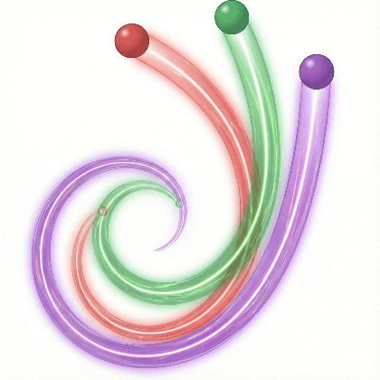

# TestParticle.jl

[](https://henry2004y.github.io/TestParticle.jl/stable)
[](https://henry2004y.github.io/TestParticle.jl/dev)
[](https://codecov.io/gh/henry2004y/TestParticle.jl)
[](https://opensource.org/licenses/MIT)
[](https://doi.org/10.5281/zenodo.10149789)



Test-particle tracing in analytical or numerical fields via [SciML](https://docs.sciml.ai/DiffEqDocs/stable/) ODE solvers and native particle pushers.

## Installation

```julia
using Pkg
Pkg.add("TestParticle")
```

Load a solver package (`OrdinaryDiffEqVerner` / `OrdinaryDiffEq` or `BorisPushers`) for integration, and `GLMakie` / `CairoMakie` / `Plots` when plotting trajectories.

## Usage

Trace a proton in a 10 nT uniform magnetic field (SI units by default) using `TraceProblem` with either a SciML ODE solver or native [BorisPushers.jl](lib/BorisPushers):

```julia
using TestParticle, OrdinaryDiffEqVerner, BorisPushers, StaticArrays

B(x) = SA[0.0, 0.0, 1.0e-8]
u0 = [1.0, 0.0, 0.0, 0.0, 1.0, 0.1]
tspan = (0.0, 20.0)

param = prepare(; B, species = Proton)
prob = TraceProblem(u0, tspan, param)

# Adaptive SciML ODE solver
sol = solve(prob, Vern7())

# Native Boris pushers (fixed-step, multistep Hyper-Boris, or gyroperiod-adaptive)
dt = 1.0e-2
sol_boris = solve(prob, Boris(); dt, saveat = 10 * dt)
sol_hyper = solve(prob, MultistepBoris6(; n = 4); dt)
sol_adapt = solve(prob, AdaptiveBoris(; safety = 0.1))
```

Plot the orbit with Makie:

```julia
using GLMakie
plot(sol; idxs = (1, 2, 3))
```

## Models and Solvers

| Model | Setup & Problem | State `u0` | Solvers | Guide |
| :--- | :--- | :--- | :--- | :--- |
| `FullOrbit` (default) | `p = prepare(; E, B, F)`<br>`TraceProblem(u0, tspan, p)` | `[x..., v...]` | `Boris`, `MultistepBoris6`, `AdaptiveBoris`, SciML ODE | [Boris Pusher](https://henry2004y.github.io/TestParticle.jl/dev/tutorial/boris) |
| `RelativisticOrbit` | `p = prepare(; E, B, F)`<br>`TraceProblem{RelativisticOrbit}(u0, tspan, p)` | `[x..., γv...]` | `HigueraCary`, `Vay`, `Boris`, `MultistepBoris6`, `Adaptive*`, SciML ODE | [Numerical Methods](https://henry2004y.github.io/TestParticle.jl/dev/tutorial/numerical_methods) |
| `GuidingCenter` | `p = prepare(; E, B)`<br>`TraceGCProblem(u0, tspan, p)` | `[X..., v∥, μ]` or `[x..., v...]` | SciML ODE (`Vern7`, `RK4`, ...) | [Guiding Center](https://henry2004y.github.io/TestParticle.jl/dev/tutorial/guiding_center) |
| Hybrid GC–FO | `p = prepare(; E, B)`<br>`TraceProblem(u0, tspan, p)` | `[x..., v...]` | `AdaptiveHybrid(; dtmax)` | [Hybrid Solver](https://henry2004y.github.io/TestParticle.jl/dev/features/demo_hybrid) |
| `Canonical` / `RelativisticCanonical` | `p = prepare_canonical(; phi, A)`<br>`TraceCanonicalProblem(u0, tspan, p)` | `[x..., p...]` | SciML ODE / symplectic | [Canonical Form](https://henry2004y.github.io/TestParticle.jl/dev/features/demo_canonical) |

- **Numerical grids**: interpolate array fields with `build_interpolator(A, grids; bc)` before `prepare`.
- **Ensembles & GPUs**: pass `EnsembleThreads()`, `EnsembleDistributed()`, or a `KernelAbstractions` GPU backend to `solve`.
- **Documentation & Contributing**: see the [Documentation](https://henry2004y.github.io/TestParticle.jl/dev/) and [CONTRIBUTING.md](CONTRIBUTING.md).
