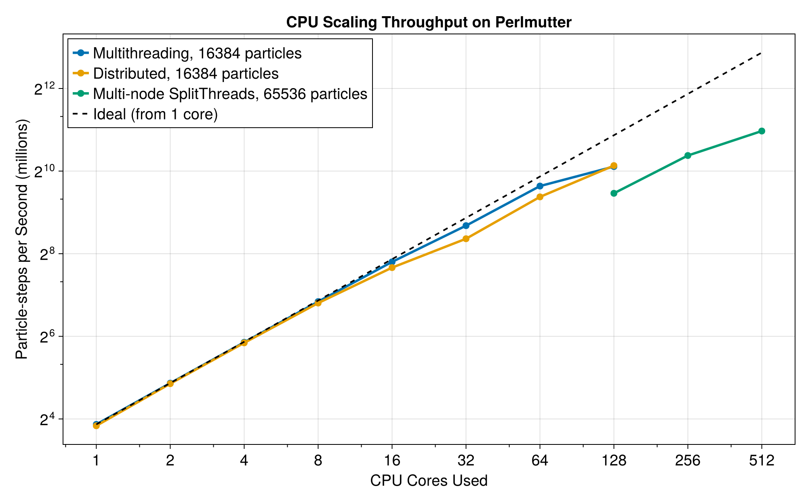
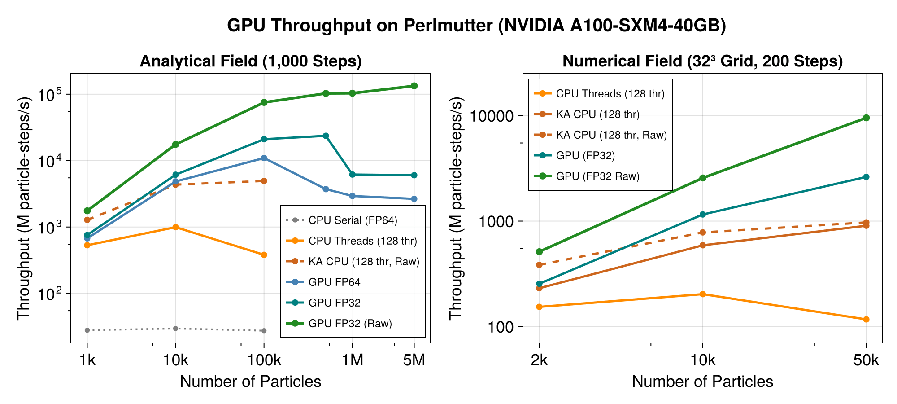

```@meta
CurrentModule = TestParticle
```

# TestParticle.jl

TestParticle.jl is a flexible tool for tracing charged particles in electromagnetic or body force fields. It supports three-dimensional particle tracking in both relativistic and non-relativistic regimes.

The package handles field definitions in two ways:

- *Analytical Fields*: User-defined functions that calculate field values at specific spatial coordinates.

- *Numerical Fields*: Discretized fields constructed directly with coordinates or using [Meshes.jl](https://github.com/JuliaGeometry/Meshes.jl) and interpolated via [FastInterpolations.jl](https://projecttorreypines.github.io/FastInterpolations.jl/stable/).

The core trajectory integration is powered by and tight to the [DifferentialEquations.jl](https://github.com/SciML/DifferentialEquations.jl) ecosystem, solving the Ordinary Differential Equations (ODEs) of motion.

To accommodate different performance needs, the API provides:

- *In-place versions*: Functions ending in `!`.

- *Out-of-place versions*: Functions optimized with StaticArrays. Note that this requires the initial conditions to be passed as a static vector.

For a theoretical background on the physics involved, please refer to [Single-Particle Motions](https://henry2004y.github.io/KeyNotes/contents/single.html).

## Installation

```julia
julia> ]
pkg> add TestParticle
```

## Usage

Familiarity with the [DifferentialEquations.jl](https://github.com/SciML/DifferentialEquations.jl) workflow is recommended, as TestParticle.jl builds directly upon its ecosystem.

The primary role of this package is to automate the construction of the ODE system based on Newton's second law. This allows users to focus on defining the field configurations and particle initial conditions. For practical demonstrations, please refer to the examples.

In addition to standard integrators, TestParticle.jl works with a native implementation of the Boris solver from [BorisPushers.jl](https://github.com/henry2004y/TestParticle.jl/tree/master/lib/BorisPushers), loaded with `using BorisPushers`. It exposes an interface similar to DifferentialEquations.jl for ease of adoption. Further details are provided in the subsequent sections. Check more in [examples](@ref).

## Performance and Scaling

Tracing many particles can be computationally intensive. TestParticle.jl is designed to scale across multiple cores and machines using Julia's built-in parallel computing capabilities.

### Serial Performance

The following table compares the performance of TestParticle's Boris solver against standard ODE solvers from DifferentialEquations.jl for a single particle simulation. Reproducible benchmark scripts are available in [benchmark/bench_serial.jl](https://github.com/henry2004y/TestParticle.jl/blob/master/benchmark/bench_serial.jl).

**Benchmark Configuration:**
- Hardware: Intel Core Ultra 7 265K (20 cores, 20 threads)
- Task: Simulating 1 particle for 0.1 second with $dt = 1$ ns ($10^8$ steps, saving endpoint).

| Solver | Median Time | Speedup | Allocations | Memory |
| :--- | :--- | :--- | :--- | :--- |
| TestParticle Boris | 477 ms | 1.0x | 91 | 4.83 KiB |
| ODE Tsit5 (fixed) | 10392 ms | 22x slower | 66 | 4.04 KiB |
| ODE Vern9 (fixed) | 24962 ms | 52x slower | 74 | 4.70 KiB |

### Parallel Scaling

TestParticle.jl supports multithreading, distributed computing, and multi-node parallelism for ensemble simulations on CPUs. The following aggregate throughput was obtained on Perlmutter CPU nodes (2x AMD EPYC 7763, 128 physical cores per node). Each ensemble traces 16384 particles for 250000 Boris steps in a uniform magnetic field, saving 100 points per trajectory. Every point is the median of repeated runs, and the error bars span the fastest and slowest repetition.

- *Multithreading*: `EnsembleThreads()` over 1 to 128 threads in one process.
- *Distributed*: `EnsembleDistributed()` over 1 to 128 worker processes on one node.
- *Multi-node*: `EnsembleSplitThreads()` with one worker per node, each worker running 128 threads, over 1 to 8 nodes.



The two single-node strategies track each other within a few percent and reach about 1.1 billion particle-steps per second on 128 cores, close to 60 percent of the single-core rate extrapolated linearly; the rest goes to the lower clock an all-core load draws. Multi-node carries on past one node and reaches 2.7 billion particle-steps per second across 8 nodes, but its one-node point sits well below the single-process runs, since `EnsembleSplitThreads` gathers every trajectory back to the master process, a cost the shared-memory path does not pay.

Reproducible scripts and the recorded measurements live in [benchmark](https://github.com/henry2004y/TestParticle.jl/tree/master/benchmark); render the figure with `benchmark/plot_scaling.jl cpu`.

### GPU Performance and Multi-Backend Scaling

TestParticle.jl provides vendor-agnostic GPU acceleration via
[KernelAbstractions.jl](https://github.com/JuliaGPU/KernelAbstractions.jl). Passing a GPU
backend such as `CUDA.CUDABackend()`, `AMDGPU.ROCBackend()`, `Metal.MetalBackend()`, or
`oneAPI.oneAPIBackend()` to `solve(prob, Boris(), backend)` executes the Boris pusher
kernels directly on hardware accelerators.

**Benchmark Environments:**
- **Workstation (Consumer GPU):** Intel Core Ultra 7 265K (20 cores, 20 threads),
  NVIDIA GeForce RTX 5070 (12 GB GDDR7)
- **HPC Node (Datacenter GPU):** NERSC Perlmutter node, AMD EPYC 7763 (128 threads),
  NVIDIA A100-SXM4-40GB

Reproducible benchmark scripts are available in
[`benchmark/compare_boris_backends.jl`](https://github.com/henry2004y/TestParticle.jl/blob/master/benchmark/compare_boris_backends.jl).

The aggregate throughput scaling across ensemble sizes on Perlmutter (NVIDIA A100-SXM4-40GB and 128-thread AMD EPYC 7763) is shown below, contrasting an analytical field with a numerical 3D discrete grid field:



Render the figure with `benchmark/plot_scaling.jl gpu`.

Key observations from the scaling throughput:
- **CPU Multithreading Contention ($N \ge 100,000$):** In the analytical field, `CPU Threads` throughput drops from ~1,000 M steps/s at $N = 10,000$ to ~380 M steps/s at $N = 100,000$. This slowdown is driven by host memory management: assembling 100,000 separate `ODESolution` wrapper objects across 128 threads creates heavy heap allocation contention and garbage collection (GC) pressure. By contrast, `KA CPU` batches particle states and maintains ~4,100 M steps/s.
- **GPU Default API Bottleneck ($N > 200,000$):** The default GPU API curves for FP32 and FP64 peak near 100,000–500,000 particles and then decline. While the GPU integrates millions of particles in a few milliseconds, the CPU host spends hundreds of milliseconds packaging up to 5,000,000 individual `ODESolution` Julia objects.
- **Unlocking Full Hardware Throughput with Raw Output:** Switching to `raw_output = true` and a bulk initial state matrix (`u0`) eliminates all per-particle host object allocations. Particle states remain in contiguous matrix buffers, allowing GPU FP32 throughput to scale continuously to over **$1.3 \times 10^{11}$ particle-steps/s** at 5 million particles.

#### 1. Analytical Field Tracing (1,000 steps)

Times below report the median wall time for an ensemble of particles traced over 1,000
steps on the RTX 5070 workstation. Speeds in parentheses are relative to CPU Serial:

| Number of Particles $N$ | CPU Serial (FP64) | CPU Threads (20 Thr) | KA CPU (FP64) | GPU (FP64) | GPU (FP32) |
| :--- | :--- | :--- | :--- | :--- | :--- |
| 1,000 | 14.15 ms | 1.62 ms (8.7x) | 0.79 ms (18.0x) | 2.27 ms (6.2x) | 0.52 ms (27.4x) |
| 10,000 | 167.31 ms | 12.89 ms (13.0x) | 5.76 ms (29.1x) | 3.09 ms (54.2x) | 0.85 ms (196.9x) |
| 100,000 | 1521.67 ms | 166.30 ms (9.2x) | 43.22 ms (35.2x) | 23.40 ms (65.0x) | 5.30 ms (286.9x) |

When returning raw matrix output (`raw_output = true` with a bulk initial state matrix,
omitting per-particle `ODESolution` wrapper assembly), host overhead is eliminated:
at $N = 100,000$, KA CPU completes in **37.69 ms**, GPU (FP64) in **13.29 ms**, and
GPU (FP32) in **1.22 ms** ($>8.1 \times 10^{10}$ particle-steps/s end-to-end). On the
Perlmutter A100, the same 100,000-particle ensemble completes in **2.33 ms** (FP64) and
**1.22 ms** (FP32).

#### 2. Numerical Grid Field Interpolation ($32^3$ Grid, 200 steps, Float32)

For discrete electromagnetic grids, TestParticle.jl automatically converts grid
interpolations into device-native
[`GPUGrid`](https://github.com/henry2004y/TestParticle.jl/blob/master/src/utility/gpu_grid.jl)
structures with hardware register trilinear evaluation:

| Number of Particles $N$ | CPU Threads (20 Thr) | KA CPU (Fair Baseline) | GPU (Default API) | GPU (Raw Output) |
| :--- | :--- | :--- | :--- | :--- |
| 2,000 | 3.39 ms | 1.67 ms (2.0x) | 0.95 ms (3.6x) | 0.75 ms (4.5x) |
| 10,000 | 11.29 ms | 6.34 ms (1.8x) | 1.64 ms (6.9x) | 0.74 ms (15.3x) |
| 50,000 | 79.71 ms | 23.99 ms (3.3x) | 4.40 ms (18.1x) | 1.26 ms (63.3x) |

> [!NOTE]
> `CPU Threads` allocates one `ODESolution` per particle, which dominates the runtime
> for grid fields. `KA CPU` provides the fair parallel CPU baseline by batching particle
> updates without per-particle object allocation overhead.

#### 3. Kernel Isolation and Theoretical Peak Performance

Because Boris integration holds particle coordinates and velocities entirely in
GPU registers throughout the step loop, the kernel performs zero DRAM reads or writes
between $t_0$ and $t_{\text{end}}$. Each Boris step performs approximately 52 floating-point
operations (FLOPs). A linear regression $t = a + b \cdot \text{steps}$ isolates host
wrapper overhead ($a$) from the pure hardware pusher throughput ($b$).

Comparing the measured kernel compute against theoretical peak hardware limits reveals
the architectural trade-offs between datacenter and consumer GPUs:

| Accelerator | Precision | Kernel Throughput | Measured Compute | Peak Hardware Vector Compute | % of Peak Compute |
| :--- | :--- | :--- | :--- | :--- | :--- |
| **NVIDIA A100**<br>(Datacenter) | FP32 | 385.1 G steps/s | 20.0 TFLOPS | 19.5 TFLOPS | ~100% |
| | FP64 | 191.6 G steps/s | 10.0 TFLOPS | 9.7 TFLOPS | ~100% |
| **NVIDIA RTX 5070**<br>(Consumer) | FP32 | 625.4 G steps/s | 31.2 TFLOPS | 38.8 TFLOPS | >80% |
| | FP64 | 9.4 G steps/s | 0.49 TFLOPS | 0.61 TFLOPS | ~80% |

- **Datacenter GPU (A100):** Hardware ALUs are engineered with a full-rate 2:1 FP32:FP64
  ratio. The Boris pusher achieves ~100% of the peak theoretical vector compute in both
  precisions, yielding an exact **2.00x speedup** for FP32 over FP64.
- **Consumer GPU (RTX 5070):** Consumer GeForce architectures feature a 1:64 hardware ALU
  rate for FP64. While FP32 delivers exceptional compute (31.2 TFLOPS, >80% of peak), FP64
  suffers a **62.4x slowdown** due to this hardware throttle.
- **Numerical Grid Interpolation:** Evaluating discrete grids ($32^3$ grid) transitions
  the bottleneck from pure ALU compute to GPU L1/L2 cache read bandwidth during trilinear
  interpolations, sustaining **55.5 G steps/s** on the A100 and **48.2 G steps/s** on the RTX 5070.

### Precision Considerations: Float64 vs Float32

TestParticle.jl supports both double precision (`Float64`) and single precision
(`Float32`) tracing. Supplying `Float32` coordinates, velocities, or time span
automatically promotes the simulation parameters, physical constants, and equations
to single precision.

#### Advantages of Float32
- **Consumer GPU Throughput:** Consumer-grade GPUs (e.g., NVIDIA GeForce RTX
  30/40/50 series) feature a 1:64 FP64 ALU throughput throttle. Where single precision
  is physically acceptable, switching to `Float32` unlocks the full hardware compute rate,
  yielding over **60x** faster pure kernel execution. On datacenter GPUs (e.g., NVIDIA A100),
  `Float32` yields the theoretical **2x** speedup over full-rate FP64 ALUs.
- **Lower Memory Footprint:** Halves VRAM and host memory consumption for trajectory
  buffers and 3D electromagnetic grids, reducing memory bandwidth pressure.
- **Reduced Host Overhead:** Memory allocations and data transfers across the PCIe bus
  are halved in size.

#### Trade-offs and Limitations of Float32
- **Accumulated Numerical Drift:** With 24 bits of mantissa (~7 significant decimal
  digits), rounding errors accumulate over long integration periods ($>10^5$ gyro-orbits),
  potentially leading to phase errors or slight artificial energy drift in non-integrable fields.
- **Dynamic Range / Catastrophic Cancellation:** In unnormalized SI units with large
  coordinate baselines (e.g. planetary magnetospheres where $r \sim 10^7$ m, but gyroradii
  or step increments are in centimeters or meters), `Float32` suffers from catastrophic
  cancellation in spatial increments.

### Computing Resource and Scaling Guidelines

Based on our CPU and GPU scaling benchmarks across problem sizes, architectures, and precisions:

| Problem Scale | Recommended Backend & Configuration | Rationale |
| :--- | :--- | :--- |
| **Small Ensembles**($N < 1,000$) | CPU Serial or `EnsembleThreads()` | Low particle counts cannot saturate GPUs; GPU initialization and kernel launch latency dominate runtime. |
| **Medium Ensembles**($1,000 \le N \le 50,000$) | `EnsembleThreads()`, `KA.CPU()`, or GPU (default API) | Both multi-threaded CPU and GPU scale efficiently. Standard `ODESolution` wrapper objects allow full SciML ecosystem integration without noticeable allocation bottlenecks. |
| **Large Ensembles**($N \ge 100,000$) | **GPU Backend with `raw_output = true`** and bulk `u0` matrix | **Avoid default per-particle `ODESolution` wrappers.** Allocating $>10^5$ heap objects on the host creates severe garbage collection contention. Raw matrix output bypasses host overhead, allowing GPUs to sustain $>10^{11}$ particle-steps/s. |

- **Precision Guidelines (Accuracy First):**
  - **Prioritize Numerical Accuracy:** Never sacrifice necessary physical precision for execution speed. Use **`Float64`** by default for single-particle orbits, long integrations ($>10^5$ gyro-orbits), and planetary-scale coordinate baselines ($r \sim 10^7$ m with small step increments) to avoid catastrophic cancellation and numerical drift.
  - **When to Use `Float32`:** Single precision should only be used when physical error tolerances allow, such as large statistical ensembles using normalized dimensionless units (e.g., coordinates scaled by gyroradius or ion inertial length).
  - **Hardware Implications:**
    - When `Float64` is required, **datacenter GPUs (A100/H100)** or **CPU clusters** are the ideal targets, as datacenter GPUs maintain full-rate FP64 ALUs (incurring only an expected ~2x compute difference relative to FP32).
    - **Consumer GPUs (GeForce RTX series)** throttle FP64 ALUs to a 1:64 rate. While they execute `Float64` with full mathematical correctness, hardware throughput is restricted. When FP64 is needed, choose datacenter GPUs or multi-core CPUs rather than downgrading precision to `Float32`.
- **Electromagnetic Field Grids:** For discrete numerical grids, use `prepare` to generate device-native `GPUGrid` structures. This leverages hardware registers and L1/L2 cache for trilinear interpolation and avoids host-side interpolation overhead.

## Presentations

For interactive presentations and educational materials, please check out these Pluto notebooks:

- [TestParticle.jl: A New Tool for An Old Problem](https://henry2004y.github.io/pluto_playground/testparticle_202401.html)
- [基于开源工具链的测试粒子模型 (Test Particle Model Based on Open Source Toolchain)](https://henry2004y.github.io/pluto_playground/testparticle_202212.html)

## Publications

- Zijin Zhang, Anton V. Artemyev, and Vassilis Angelopoulos, 2025, "Quantification of ion scattering by solar-wind current sheets: Pitch-angle diffusion rates", Phys. Rev. E, https://doi.org/10.1103/pkzv-k5t3
- Chi Zhang, Hongyang Zhou, Chuanfei Dong, Yuki Harada, Masatoshi Yamauchi, Shaosui Xu, Hans Nilsson, et al. 2024. “Source of Drift-Dispersed Electrons in Martian Crustal Magnetic Fields”, The Astrophysical Journal, https://doi.org/10.3847/1538-4357/ad64d5.

## Acknowledgement

`TestParticle.jl` is acknowledged by citing the Zenodo DOI: [](https://doi.org/10.5281/zenodo.10149789).

Nothing can be done such easily without the support of the Julia community. We appreciate all the contributions from developers around the world.
